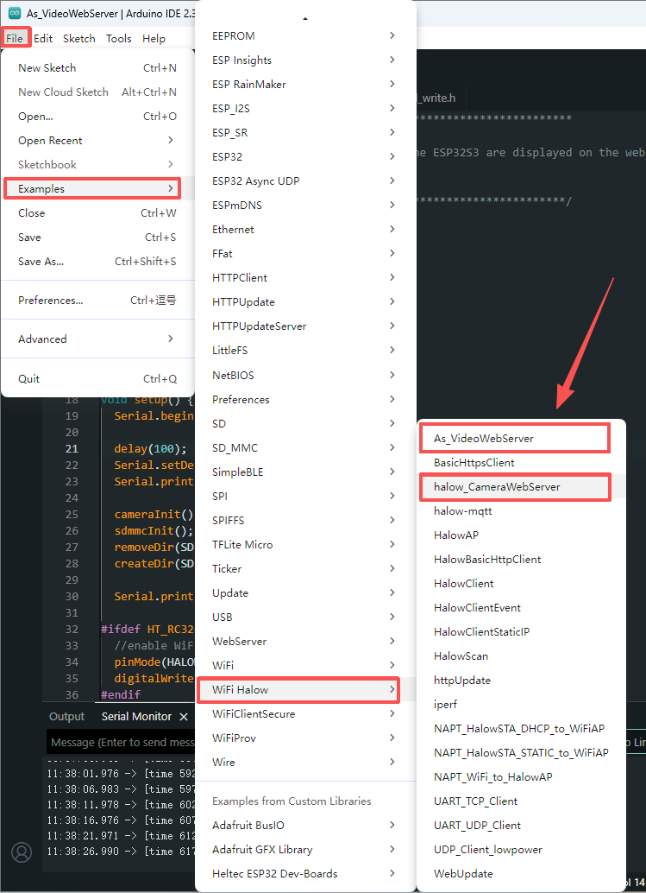
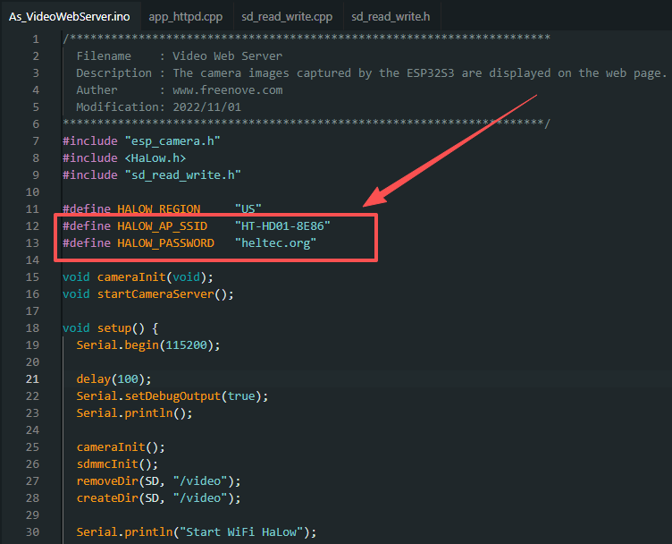
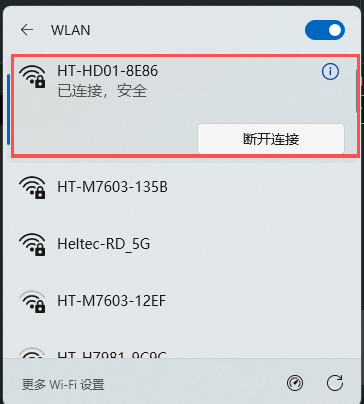
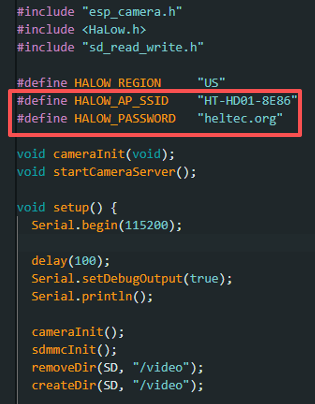
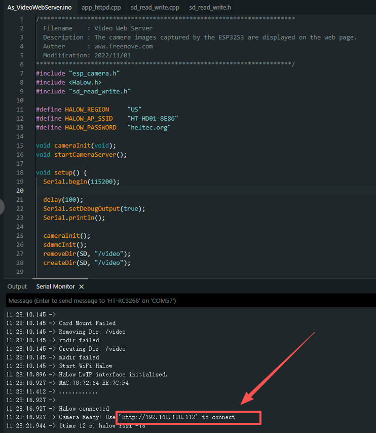
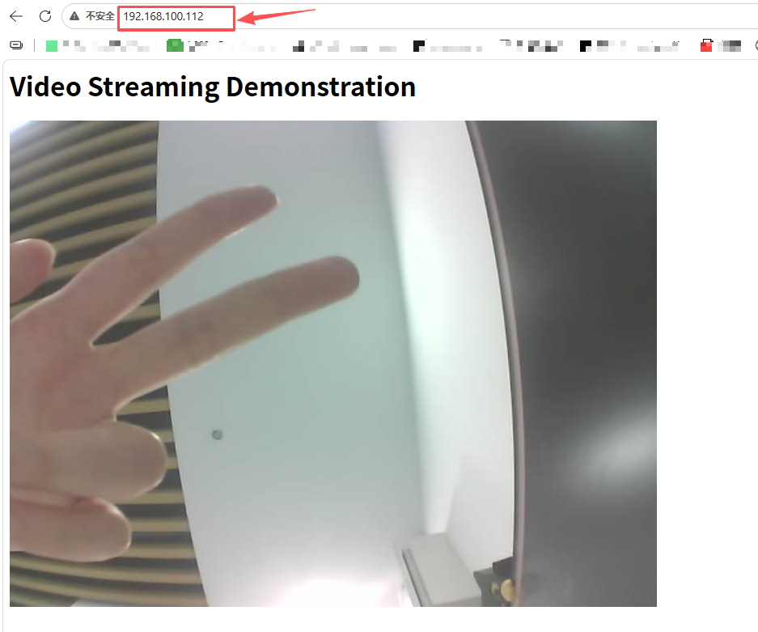

# RS-CP01 Quick Start

> Before getting started, refer to **[this document](/docs/devices/open-source-hardware/radio_core_series/rc32/rc3268/rc3268_dev)** to complete the development environment setup.

The RC3268 Expansion Kit Quick integrates a camera, allowing users to view real-time video through a Web interface.

## 1.Run the Camera Web Server Example

Open and one of the following example codes: **`As_VideoWebServer`** or **`halow_CameraWebServer`**

## 2.Configure the HaLow AP Connection

*In the example code, modify the **HALOW_AP_SSID** and related network parameters according to the actual **HaLow AP device** you are using.*

:::warning
To use the camera function, the camera expansion box must connect to a **HaLow AP with network bridging capability**, such as the **HT-HD01 Dongle or HT-H7608 WiFi HaLow Gateway**.
The RC3268 expansion kit works as a HaLow Client. Direct connection to the RC3268 HaLow AP Mode is not supported because it does not provide the required network bridging function.
:::

## 3.Network Requirements

Make sure the RC3268 expansion kit and your computer are connected to the **same local network and subnet** to access the camera webpage.

## 4.Check the Camera IP Address

After completing all configurations and uploading the code, the camera webpage address will be displayed in the serial monitor. 

Open the IP address in a browser to view the live video stream.

:::note
The current version of the camera expansion box does not include an SD card interface. Therefore, video recording and SD card storage functions are not supported at this time.
:::