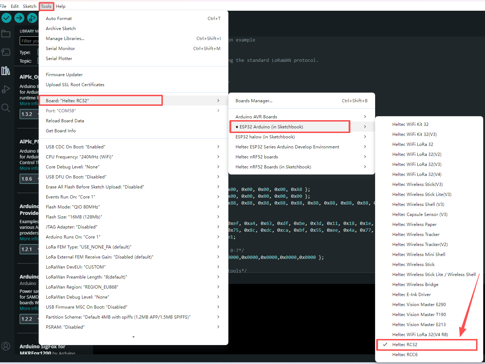

## Development Environment

**For a New Installation:** If you are setting up the ESP32 development environment for the first time, follow the standard **[ESP32 Development Environment Installation](/docs/devices/open-source-hardware/esp32-series/esp32-quick-start?esp32=esp32)** procedure. 

**For an Existing Installation:** If you already have the ESP32 development environment installed, we recommend using Git to pull the latest changes from the **[WiFi_Kit_series](https://github.com/Heltec-Aaron-Lee/WiFi_Kit_series)** repository. After updating the repository, rerun **`get.exe`** in the **`tools`** directory to update the dependencies required for RC3262 development.

Once the development environment is installed, select the **RC32** development board in your development tool, then select and run the appropriate example code.

