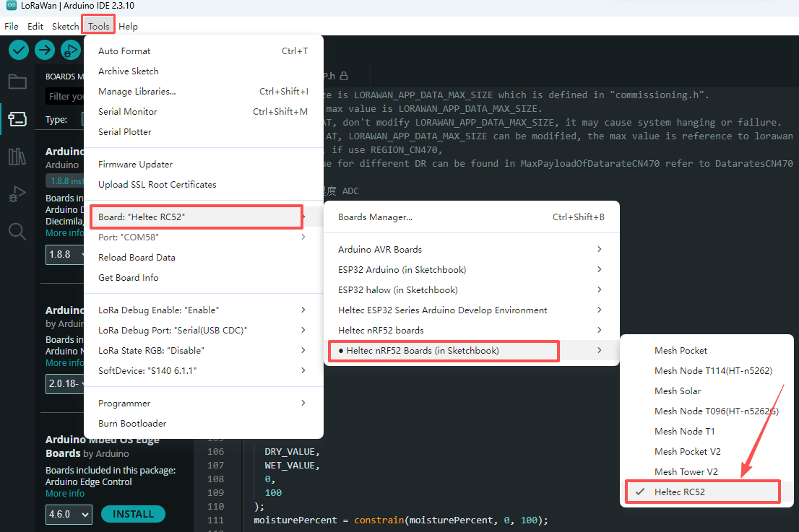

## Development Environment

**For a New Installation:** If you are setting up the nRF52840 development environment for the first time, follow the standard **[nRF52840 Development Environment Installation](/docs/devices/open-source-hardware/nrf52840-series/nrf52840-series-quick-start)** procedure. 

**For an Existing Installation:** If you already have the nRF52840 development environment installed, we recommend using Git to pull the latest changes from the **[Heltec_nRF52](https://github.com/HelTecAutomation/Heltec_nRF52)** repository. After updating the repository, rerun **`get.exe`** in the **`tools`** directory to update the dependencies required for RC52 development.

Once the development environment is installed, select the **RC52** development board in your development tool, then select and run the appropriate example code.

