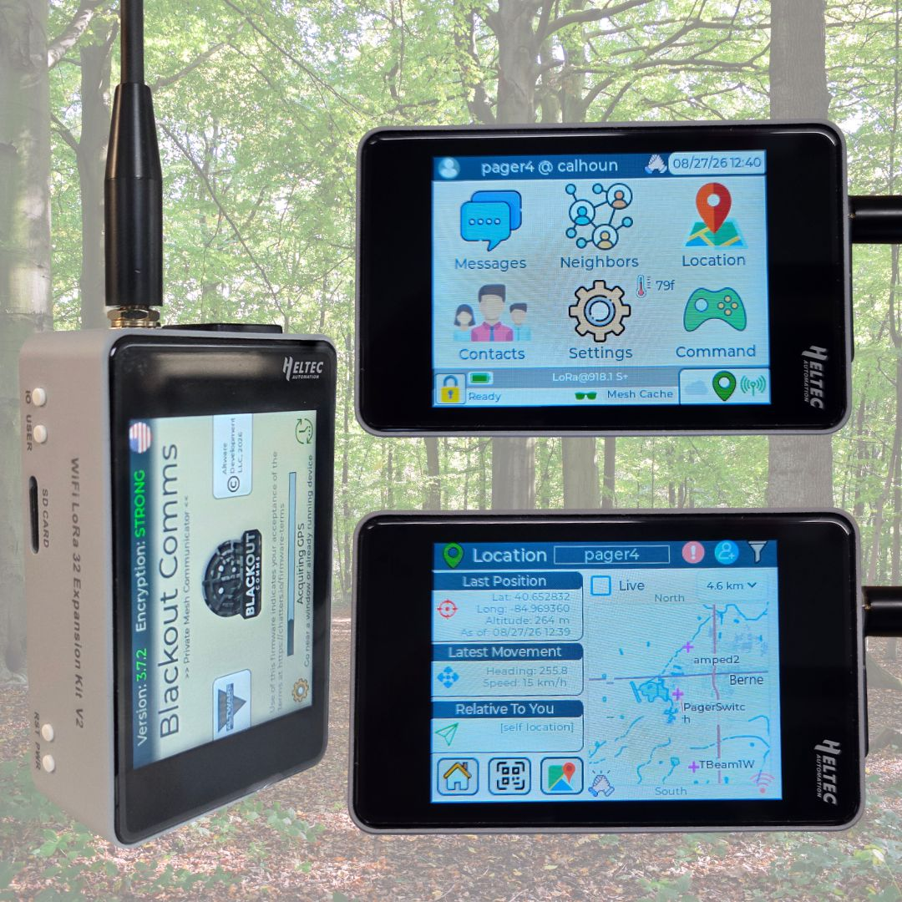
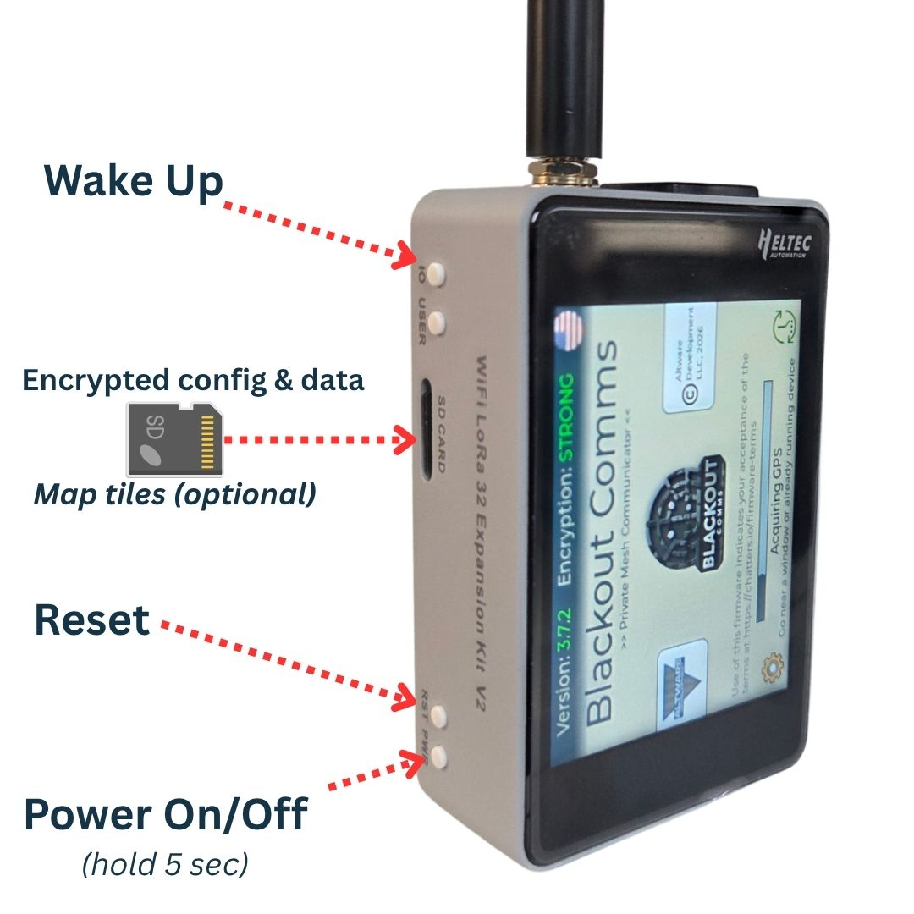
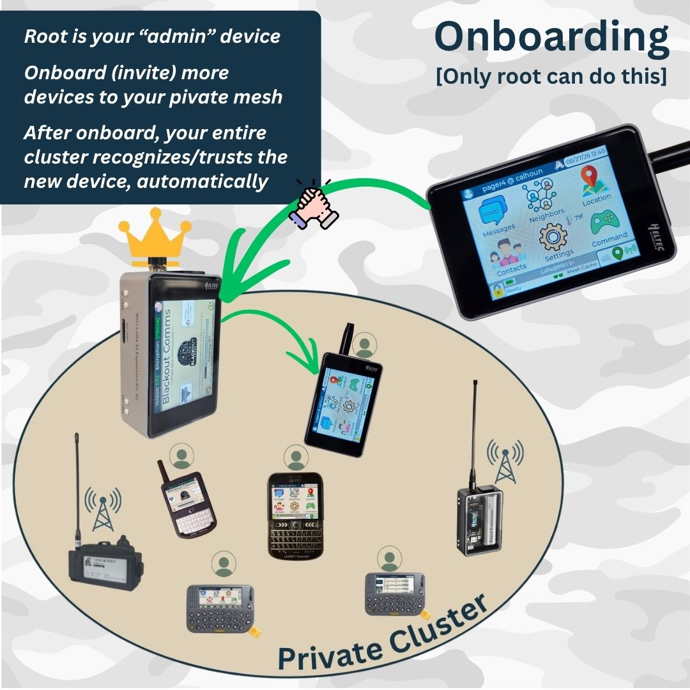
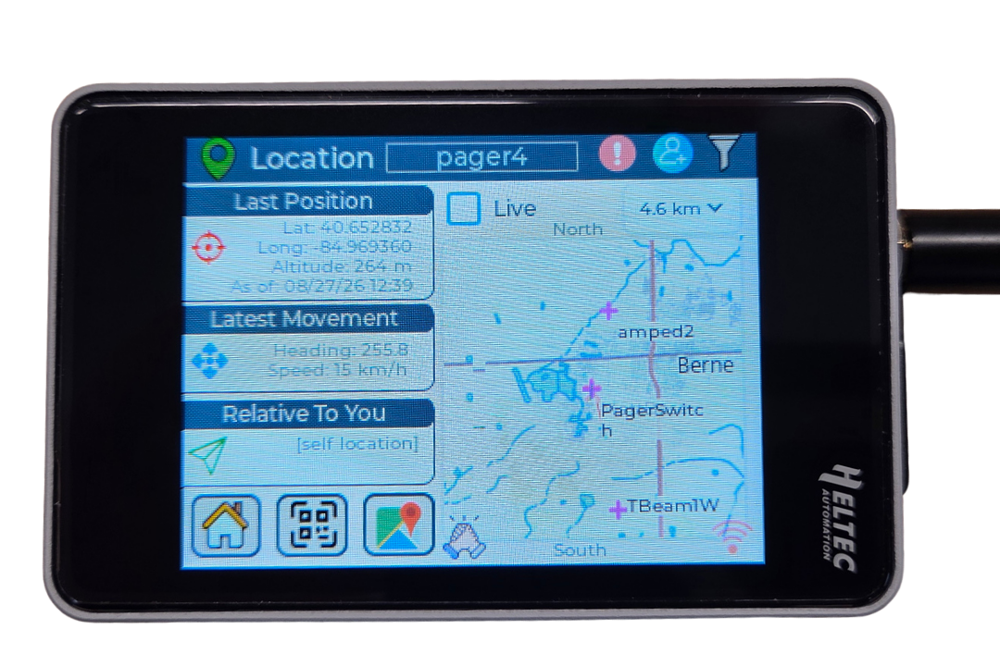
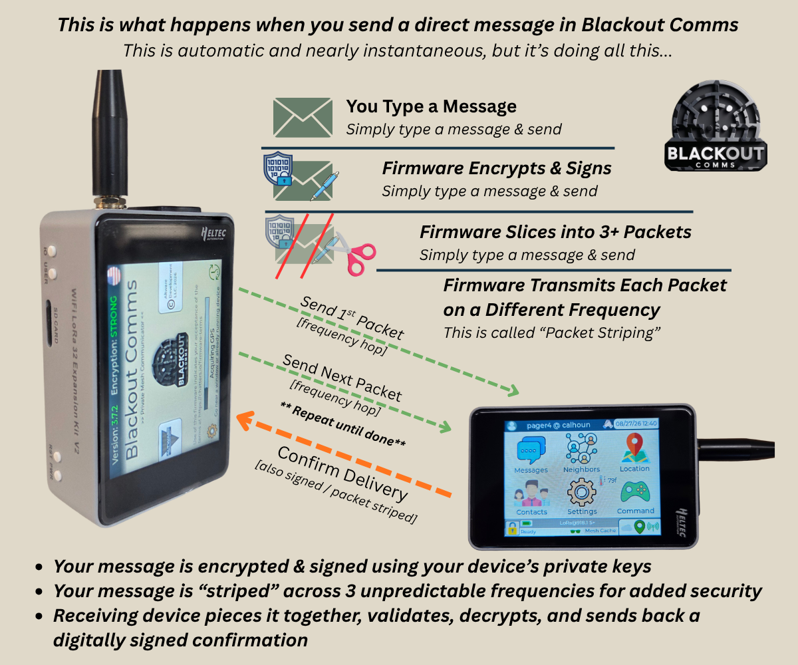
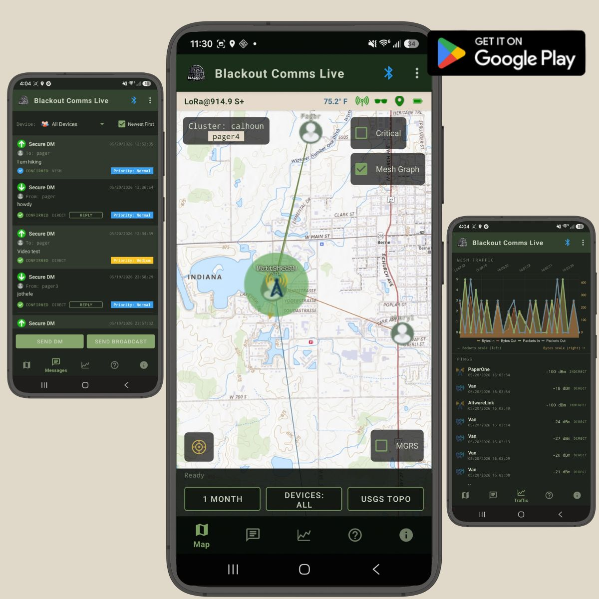
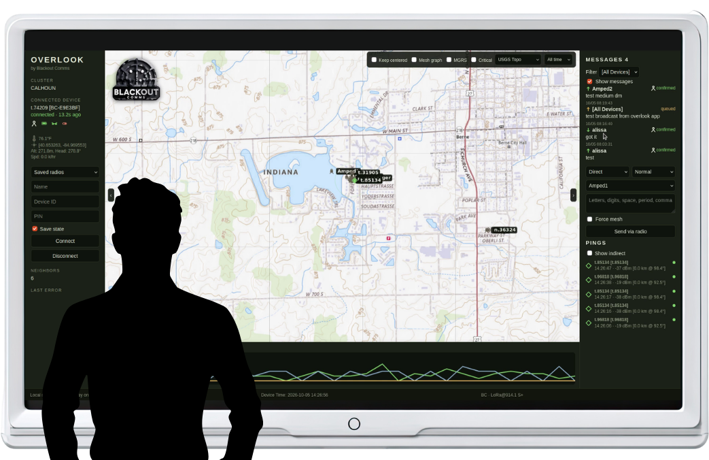
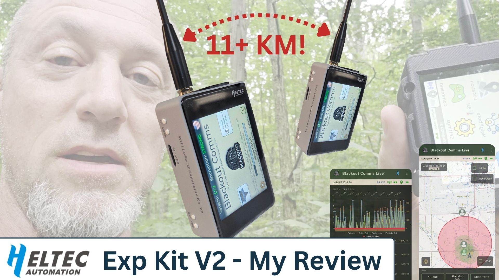

# Blackout Comms on the Heltec WiFi LoRa 32 Expansion Kit V2 (R8): Private Off-Grid Messaging and Location with On-Device Maps

[Blackout Comms](https://chatters.io) is [private-cluster](https://www.chatters.io/blackout-comms-clusters) LoRa mesh firmware for encrypted texting, location sharing, and mesh memory. It runs without phones, cell service, or internet. The Heltec WiFi LoRa 32 Expansion Kit V2 (R8) touchscreen has proven to be a very strong platform for it.

## Project Background and Motivation
My family and I often go camping and traveling in locations that don't have cell service at all, and this allows us to track & text over fairly long distance, in the complete absence of grid services.

[Blackout Comms](https://chatters.io) was built to address that gap for small trusted groups (like families) that need reliable text and location when infrastructure is unavailable or unreliable. It prioritizes [privacy](https://www.chatters.io/security), [persistence of messages](https://www.chatters.io/mesh-memory) and [last-known positions](https://www.chatters.io/location), [frequency hopping](https://www.chatters.io/frequency-hopping-enhancing-signal-security-lora-mesh), and simple on-device use. 

A secondary goal was making the system work on readily available and inexpensive LoRa hardware without requiring a phone for core operation. Since the original implementation, I quickly realized some people _prefer_ to use an app, so I also created open source companion apps for Android, Windows, and Linux. 

## Why the Heltec V4 Expansion Kit V2 (R8)

The R8 Expansion Kit offers a compact touchscreen handheld form factor, solid SX1262 radio with external amplifier, microSD slot, and enough PSRAM/flash for [offline maps](https://www.chatters.io/location) and a responsive UI. These match Blackout Comms’ needs for on-device mapping and a phone-optional experience better than many bare development boards.

One thing that sets the Heltec v4 Exp Kit apart from most other LoRa devices is its integrated LNA (low-noise amplifier). This drastically increases practical range of the device, as you'll see further down in the demo.

## Hardware Configuration

- Heltec WiFi LoRa 32 Expansion Kit V2 (R8) touchscreen
- MicroSD card (recommended, installed before flashing for maps)
- Optional BME280 sensor and buzzer for environmental data and alerts
- Standard LoRa antenna (SMA)

Older Expansion Kit variants (touchscreen and glass/OLED) also work; they use a different firmware build.

## Blackout Comms Architecture and Firmware Workflow
Blackout Comms uses a private-cluster model. One device acts as the root for onboarding. Devices form a trusted mesh with asymmetric encryption, digital signatures, and frequency hopping. Direct messages can be held in the mesh for up to 24 hours for later delivery. Location and status are shared within the cluster.

Flashing is done through a web installer. Select the R8 / Expansion Kit V2 build, connect the device, and flash. After flashing, create or join a cluster on the device itself.

## Offline Mapping and MicroSD Usage
The R8’s microSD slot and memory allow offline map tiles to be stored and displayed on the device. Maps remain available without a phone or internet. Install the card before flashing for the smoothest experience. 

## Encryption, Cluster Communication, and Message Delivery

- End-to-end [asymmetric encryption and ECDSA signatures](https://www.chatters.io/security) on messages and location data
- Unpredictable [frequency hopping](https://www.chatters.io/frequency-hopping-enhancing-signal-security-lora-mesh) with packet striping
- [Mesh memory](https://www.chatters.io/mesh-memory) of last-known positions, heading, and status for offline or out-of-range devices
- Delivery confirmations and up to 24-hour hold for direct messages
- Optional bridges (e.g., MQTT or [Mesh Cloud](https://www.chatters.io/cloud)) when internet is available, while keeping end-to-end encryption

## Companion Apps for Android, Linux, and Windows
Blackout Comms is designed specifically to _not_ require any phones or apps, _but_ companion apps are available that can make certain things easier. As you'll see in the field test, I do often use the Blackout Comms Live app for Android, as zooming/swiping on a map, checking for connectivity pings, and certain other test-type activites are just faster to do on a phone. Currently, there are 2 companion apps available.
### Blackout Comms Live for Android

- Connects to the Heltec via BLE
- Shows a dashboard of your connected device (connectivity, temperature, battery level, current stealth mode, etc)
- Maps the current or last-known locations of all devices in your cluster
- Shows connectivity (the Mesh Graph) throughout your cluster, allowing you to see which devices have good connectivity
- Allows sending/receiving of encrypted messages and broadcasts
- Analyzes/charts your cluster's mesh traffic, all the way down to individual pings/packets
- Automatically downloads map tiles as needed, which remain cached on your phone/tablt for fully offline use
- [Open Source](https://github.com/mattcalhoun1/BlackoutCommsLive) - or get it in the [Google Play Store](https://play.google.com/store/apps/details?id=com.blackoutcomms.live)
- [Learn more](https://www.chatters.io/using-blackout-comms-live)

### Overlook for Windows and Linux

- Connects to the Heltec via BLE
- Suitable for laptops, Raspberry PIs; Looks great on large screens
- Shows a dashboard of your connected device
- Maps the current or last-known locations of all devices in your cluster
- Shows connectivity (the Mesh Graph) throughout your cluster, allowing you to see which devices have good connectivity
- Allows sending/receiving of encrypted messages and broadcasts
- Charts your cluster's mesh traffic level
- Automatically downloads map tiles as needed, which remain cached on your phone/tablet for fully offline use
- [Open Source](https://github.com/mattcalhoun1/BlackoutCommsLive) - or get it in the [Google Play Store](https://play.google.com/store/apps/details?id=com.blackoutcomms.live)
- [Learn more](https://www.chatters.io/using-blackout-comms-live)

## Field-Test Setup and Methodology

Tests used pairs of R8 Expansion Kits running current Blackout Comms firmware. Devices were configured for the same region and cluster. Range tests measured direct (non-meshed) delivery of messages and location updates under real terrain conditions, including wooded areas to a base location. Companion apps (Blackout Comms Live on Android and Overlook on desktop) were used for monitoring.

## Watch the Demo

## Range Results

Reliable direct messaging and location updates were achieved at distances exceeding 11 km. These results were obtained with standard antennas under typical outdoor conditions.

One woods-to-base transmission covered approximately 13 km (8 miles), using a standard Heltec v4 R8 at one end and some less typical equipment at my house.

## Lessons Learned and Recommended Configuration

- Install a microSD card before flashing if on-device maps are desired.
- Include the BME sensor and buzzer for maximum features and audible alerts.
- Use the correct firmware build (R8 vs. older Expansion Kit).
- Place always-on links/nodes with good line-of-sight to improve mesh resilience.
- Frequency hopping and mesh memory provide practical benefits in interference-prone or intermittent environments.

## Links and Resources
- [User Guide](https://content.chatters.io/guide/index.html) - Detailed firmware user guide
- [Firmware for Heltec v4](https://content.chatters.io/esp32/heltec_v4_exp_installer.html) - Flashing tool for the Heltec v4 Exp Kit (all versions)
- [Mesh firmware for other devices](https://content.chatters.io/esp32/index.html) - Many other devices are compatible, including the Heltec e290 Vision Master
- [Blackout Comms Live](https://www.chatters.io/using-blackout-comms-live) - Companion app for Android
- [Overlook](https://www.chatters.io/overlook) - Companion app for Linux and Windows
- [Main site](https://chatters.io) - Learn more about Blackout Comms
- [Field test video](https://www.youtube.com/watch?v=__C46vcC0TI) - Demo of using and setting up the Heltec
- [Heltec product page](https://heltec.org/project/v4-r8-ex/) - Get devices from Heltec
- [Mesh Planning Tool](https://meshplan.chatters.io/) - Plan your own mesh network & view coverage

The R8 Expansion Kit V2 provides a practical handheld platform for advanced private mesh applications beyond standard Meshtastic use cases. Pre-flashed units are also available for users who prefer a ready-to-run configuration.

---

*Blackout Comms is developed by Altware Development LLC. Firmware is free for supported devices; certain cluster features may require a license.*