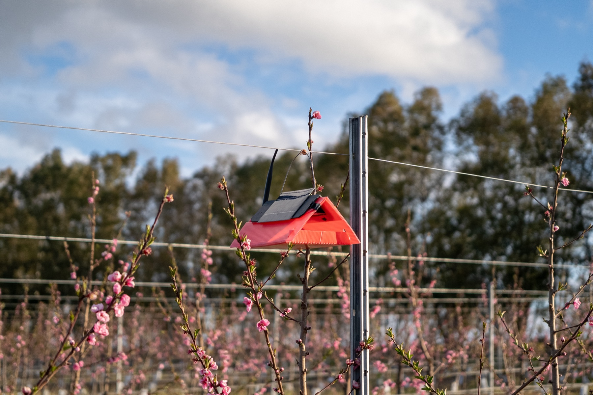
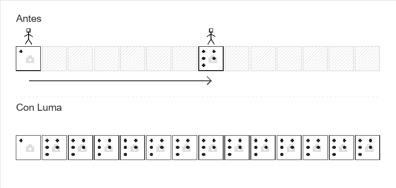
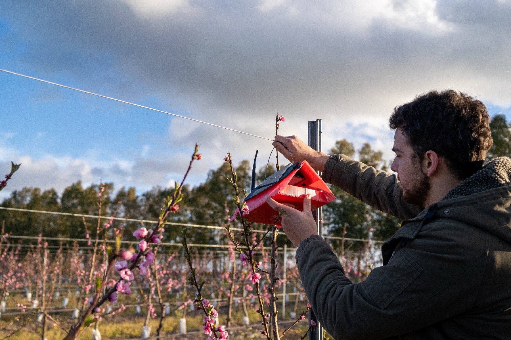
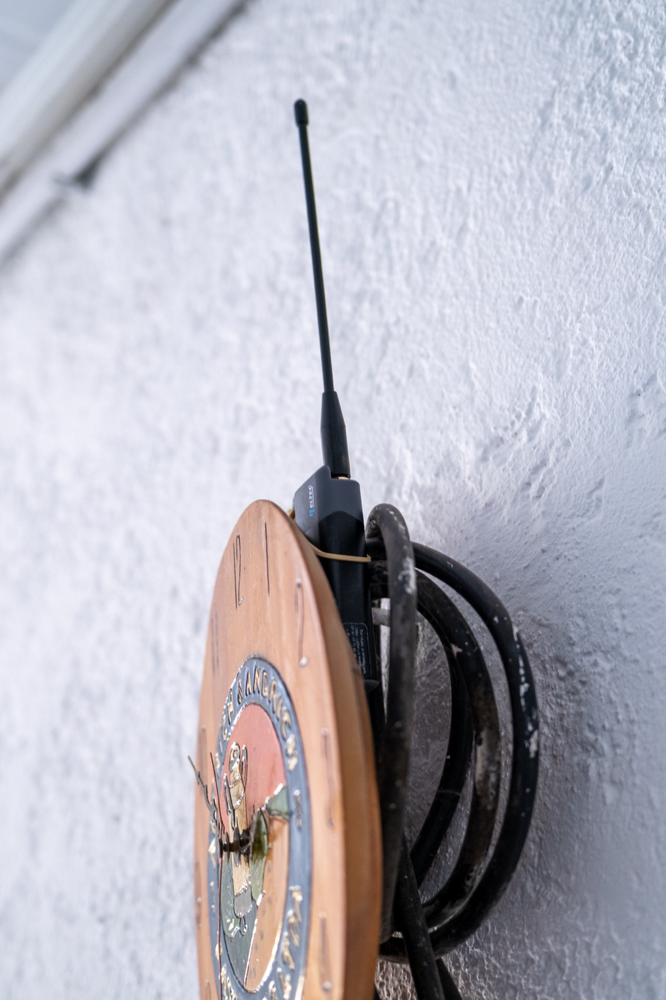
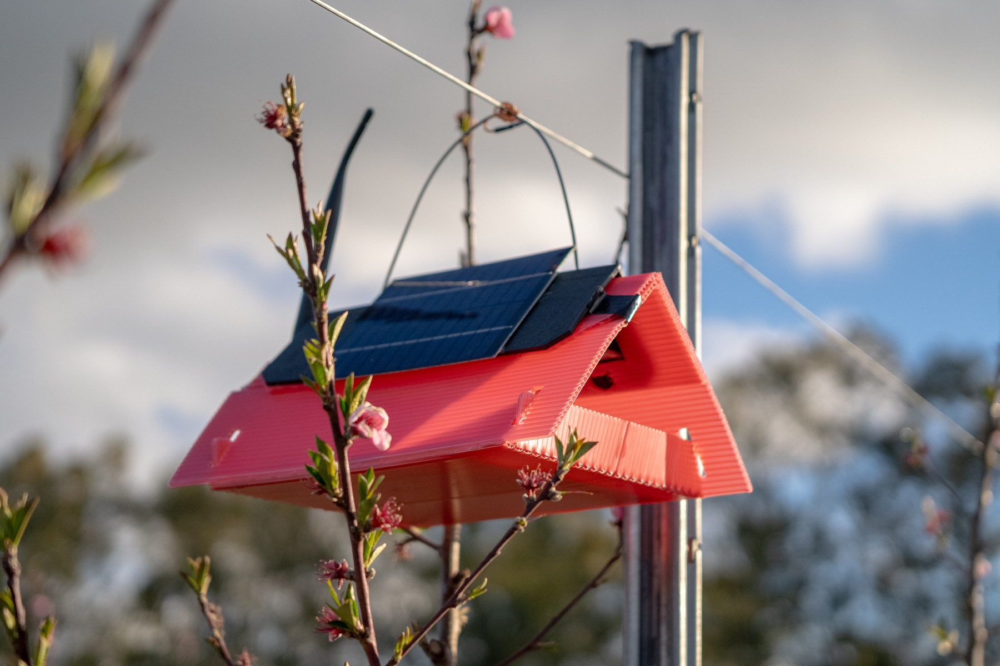
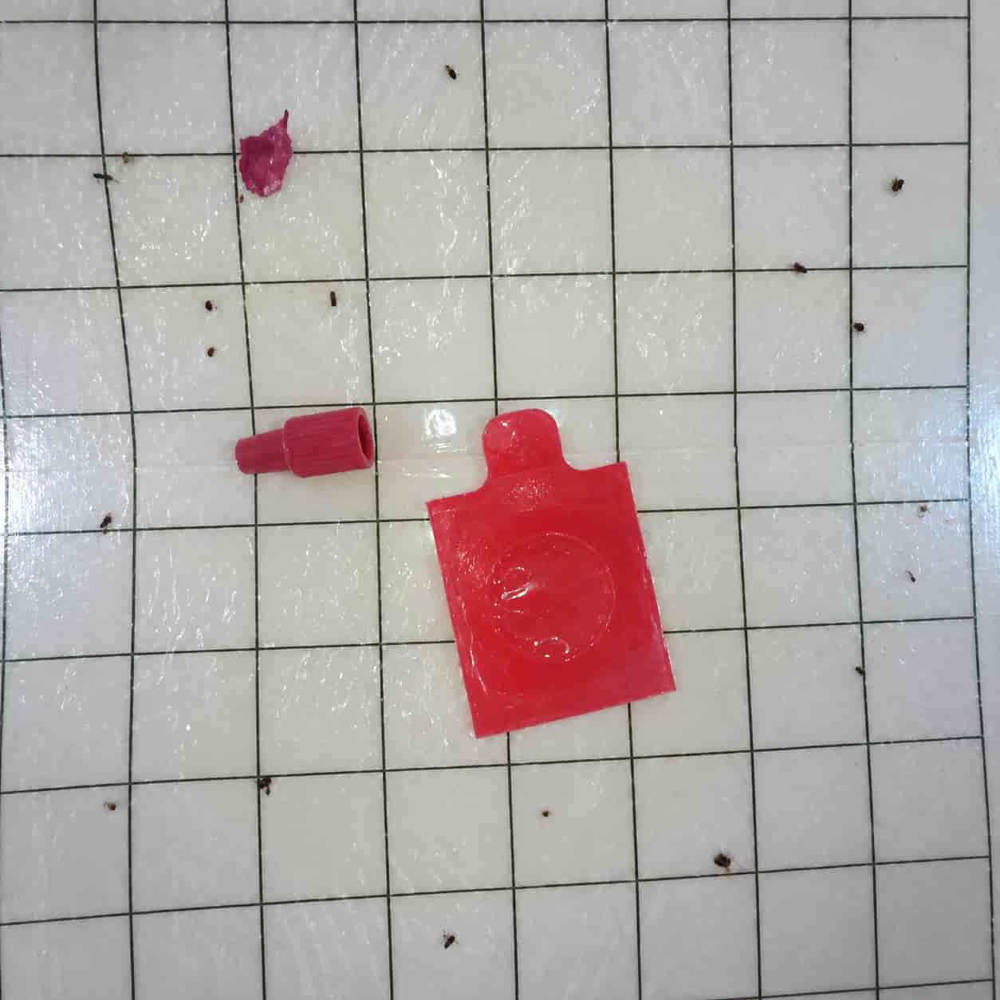
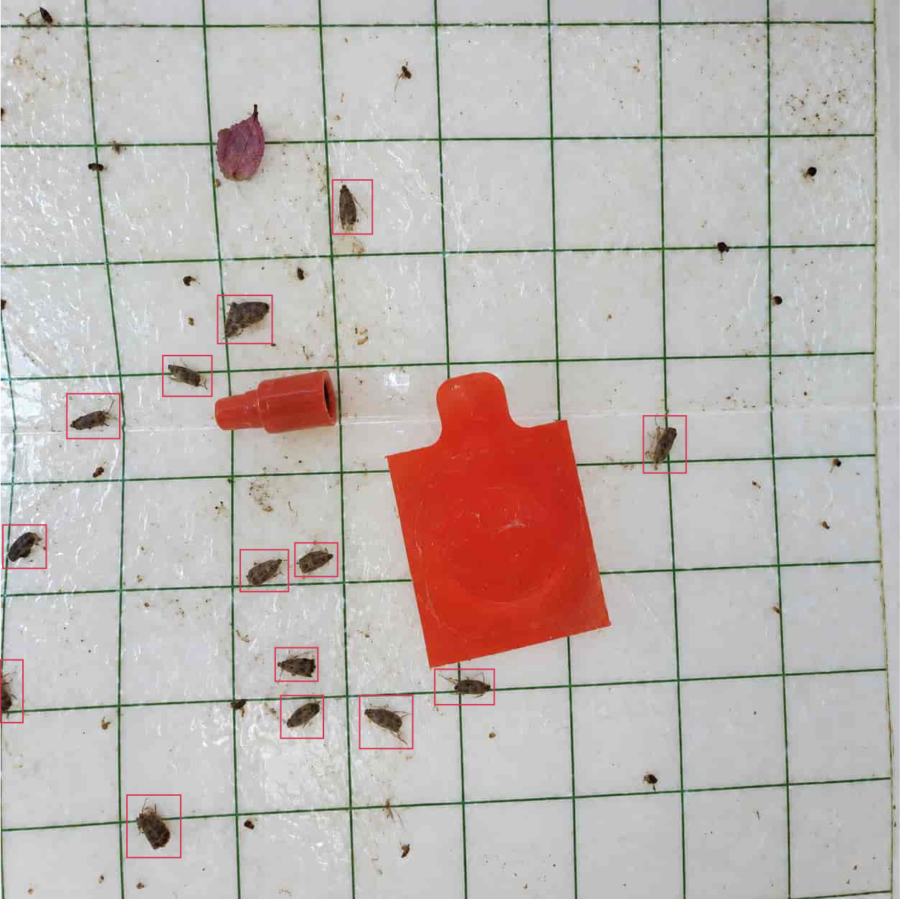
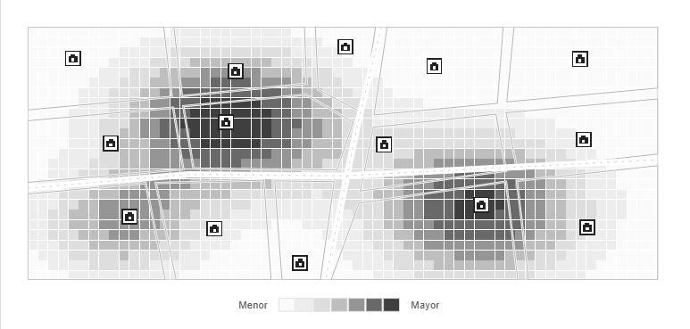

### Context
A few years ago, a family story prompted us to try to detect changes early on that might go unnoticed during visits. Ariel Pérez, Sebastián's father, was in charge of citrus orchards when a plague suddenly broke out and most of the crop was lost. Nothing like that had ever happened there before.

We chose to start with the delta trap: the producer already knows it, the problem is contained, and between visits a pest can grow without anyone noticing.

The trap takes and sends a photo every day. This allows us to see if insects are starting to fall in without waiting for the next sweep.

This is what we aim for with Luma: clarity and reliable data in real time. On the outside, it's a standard delta trap. Inside, it houses a solar panel, a [**ESP32 Wi-Fi HaLow**](https://heltec.org/project/ht-hc33/) board with HaLow Wi-Fi, and a camera.
Before discussing artificial intelligence or alerts, we need to answer the basics:
- Is the connection reliable, does the battery last, and does the trap hold up in the field?
- Do you take and send photos every day?
- Do photos allow us to tell what's falling?

### How we did the test
We hung the trap in a plum and peach orchard in San José, Uruguay. The trees were in bloom. We placed it on the wire, at branch level, where the traps were already being checked.
We used an attractant in the trap. We were looking for codling moth, but we didn't check if all the captured specimens were of that species.

The trap was located about 100 meters from the office, where we installed the HaLow internet-connected access point. The signal passed through two walls and several rows of plants.

 

In this test we used Wi-Fi HaLow instead of 4G. In the previous test, the cellular signal was insufficient to reliably send the photos.
The trap took a photo every day at 12:20 and sent it. We also requested some extra photos from the office. We left the same adhesive flooring in place throughout the test, which is why the insects accumulated.
Until Thursday the 17th, the photos showed other insects, but no moths of interest. On Friday the 18th, we counted 14 specimens. After the peak, the daily catches were 3, 3, 10, and 0.

### From 0 to 14 in 24 hours

On Thursday the 17th at 12:20 other insects were seen, but no moths of interest.

**Thursday 17, 12:20: other insects are seen, but no moths of interest.**

On Friday the 18th, at the same time, we counted 14 specimens of interest. The previous photo did not show any.

**Friday 18, 12:20: 14 copies marked with red boxes.**

Upon seeing the jump from 0 to 14, the local agronomist told us that he liked being able to check the trap online and the possibility of receiving alerts when the catches increased.
The trap continued sending photos. The captures varied from day to day.
To determine if pest control is necessary, the species, the crop, and the stage of infestation must be considered. This test did not assess these factors. It still needs to be repeated with more traps and in different locations.

### What we learned in the field

It's funny, but what we learned most had to do with how we held the trap.
The trap hung from a wire, and the wind blew it from side to side. At one point, it ended up leaning against a plant, which covered its solar panel. Without power, the battery died, and the trap stopped working. We removed it to recharge it and reinstalled it.
On another occasion, the wind blew the antenna inside a metal pipe, and we stopped receiving photos. We believe the metal blocked the signal. When we removed the antenna, we started receiving them again.
We're going to install a fixed antenna, pointing upwards, and secure the trap better with tape or a hook attached to the wire or the plant. We want to prevent it from moving and the panel from being covered.
Cloudy days weren't a problem. The battery is small, but the trap is off most of the time and the solar panel recharges it. The power outage occurred when a plant covered the panel.
With the antenna free, the photos arrived at the office and looked good enough to count the insects.

### What does this test prove?
- The trap worked in the field.
- The panel kept the battery charged, even on cloudy days, as long as it received light.
- One photo per day and extra photos when we ask for them.
- We validated the usefulness of having daily information to alert in time when captures increase.

### Next steps
The next step is to connect several traps and add up the automatic count. This will allow us to track captures from different locations each day and see on a map where pest pressure is increasing.
By expanding this network, the data can be used to generate alerts and develop predictions for producers, companies, and institutions. The idea is to help them detect increases early and decide where to focus their attention.

We were able to observe from the office how a trap changed in the field. Now we need to test if we can reliably do this with more traps.

**Sources: photos sent by the trap in September 2026, photos of the installation, and internal LUMA records. We counted the insects by looking at the photos. The previous test is in “Wi-Fi HaLow Field Test.”**
**https://lab.luma.uy/publicaciones/ya-validamos-en-campo**