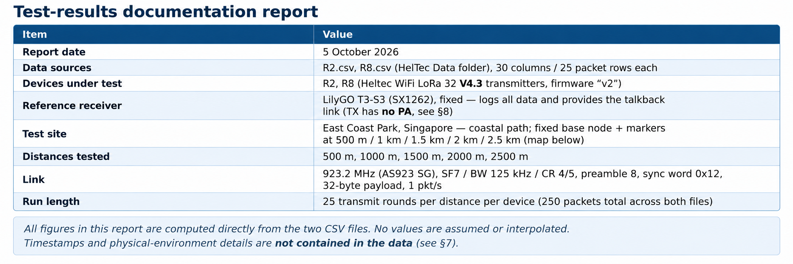

### 1.Test Summary
---

#### Purpose. 
Compare the RF performance of two [**Heltec WiFi LoRa 32 V4**](https://heltec.org/project/wifi-lora-32-v4/) transmitter boards — R2 (ESP32-S3R2variant, Vext = GPIO36) and R8 (ESP32-S3R8 variant, Vext = GPIO40) — against one fixed LilyGO T3-S3 reference receiver, over distance, including full round-trip (talkback) verification of the return path.

#### Test site.
All runs were performed along the coastal path at East Coast Park, Singapore (parallel to the ECP).The reference/base node sits near East Coast Pk Area D; test points are marked at 500 m, 1 km, 1.5 km, 2 km and 2.5 km along the shore — open, flat, mostly low vegetation, with one exception at the 2 km point (trees blocking line of sight; see §4 and §7).

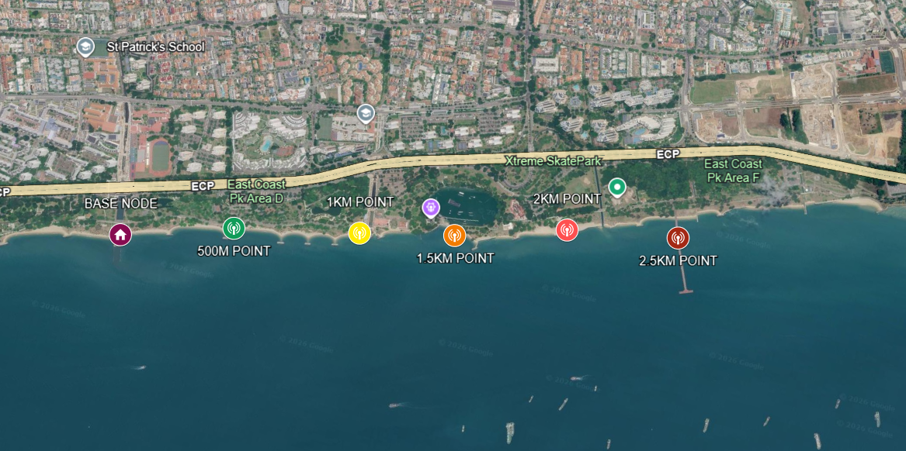
> *Test site map: East Coast Park coastal path with base node and 500 m / 1 km / 1.5 km / 2 km / 2.5 km markers*

#### Equipment and configuration.

- **R2 / R8:** Heltec V4.3 hardware, KCT8103L front-end module (FEM), ≈22 dBm radiated (SX1262 register 11 dBm + ~11 dB FEM gain). Both run firmware "v2" with identical radio settings.

- **T3-S3:** Fixed reference receiver and talkback transmitter; logs every packet to CSV. **Its transmitter has no power amplifier**, so its radiated talkback power is well below the Heltec's ~22 dBm FEM output (see §8).

- **Radio (identical on all three):** 923.2 MHz (AS923, Singapore 915–928 MHz), SF7, BW 125 kHz, coding rate 4/5, preamble 8 symbols, sync word 0x12 (private), fixed 32-byte payloads, 1 packet per second.

#### Round-trip protocol (per 1-second slot).

1. Heltec → T3-S3: data packet `(id),(seq)`.

2. T3-S3 → Heltec: talkback `T3,(seq)` (PA-less transmit, see §8).

3. Heltec → T3-S3: ack `AK,(seq),(rssi),(snr)` — the Heltec's measured RSSI/SNR of the talkback (this is the TB_RSSI / TB_SNR columns).

Each waiting window is 200 ms. If no talkback arrives, the T3-S3 still logs the data packet but writes `-,-` in the TB columns.

#### Column semantics.

1. `*_RSSI` / `*_SNR`: forward link, data packet as received by the **T3-S3**.

2. `*_TB_RSSI` / `*_TB_SNR`: return link, talkback as **received by the Heltec** (relayed in the ack).

3. `*_Transmission`: session verdict — **PASS** = every packet completed a full round trip; **MARGINAL** = some talkbacks failed; **FAIL** = data received but no talkback at all.

#### What was covered. 
Both devices were tested at all five distances: 25 packets per distance per device (5distances × 25 packets × 2 devices = 250 packet slots; 246 were recorded). No FAIL and no blank verdicts
occurred in either file. All statistics below are computed from the recorded rows only.

#### Not covered by the data. 
The CSVs contain no date/time, antenna heights, orientation, or weather. The siteitself is documented above (coastal path, East Coast Park), and the 2000 m obstruction is known (trees blocking line of sight), but per-run conditions cannot be determined from the files alone (see §7).

### 2.Per-Device, Per-Distance Statistics
---

"Packets recorded" is counted against the expected 25 rows per run. "Loss %" is therefore missing rows, not necessarily over-the-air packet loss (see §7). TB success counts only rows where a talkback value was logged.

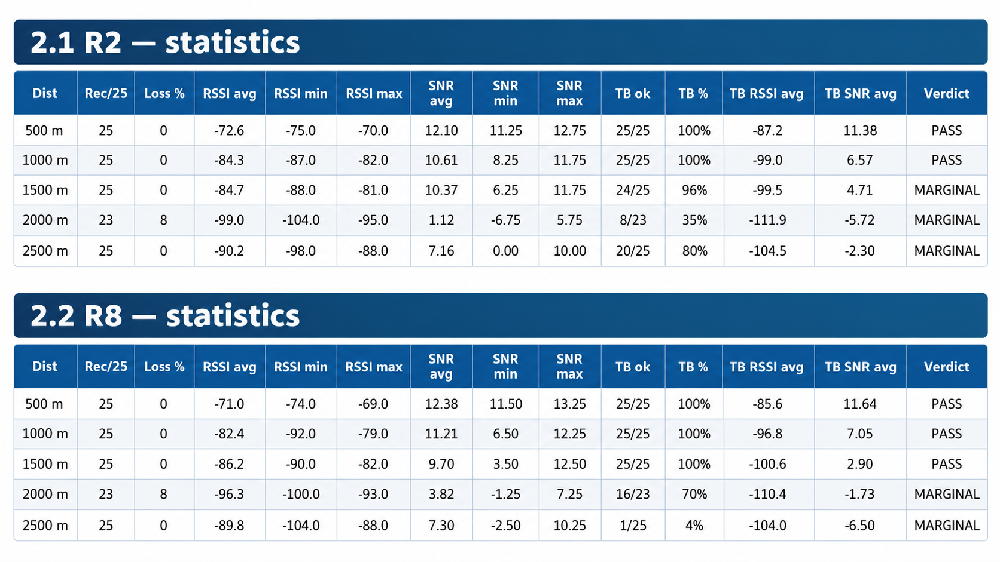

#### Totals. 
Both devices recorded **123/125** packets. Overall talkback success: **R2 = 102/123 (82.9 %), R8 =92/123 (74.8 %).**

#### 2.3 Headline plots

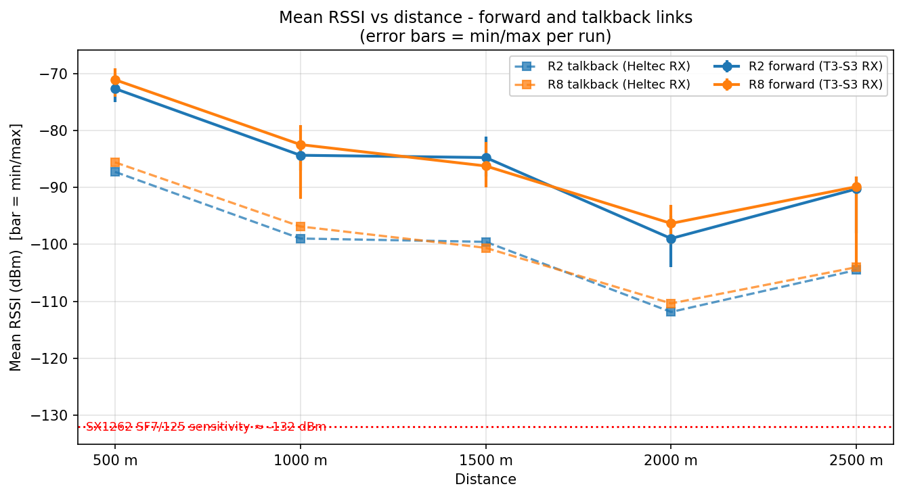
> *Mean RSSI vs distance for both devices, forward and talkback links*

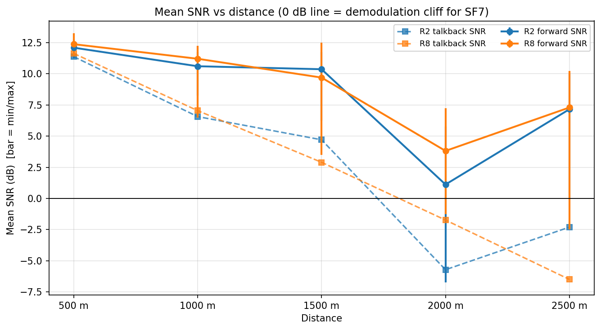
> *Mean SNR vs distance for both devices, forward and talkback links*

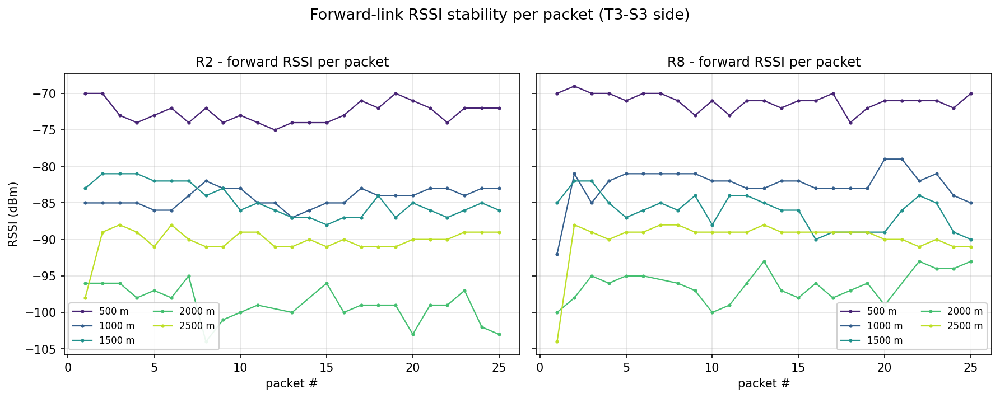
> *Forward RSSI per packet for every distance, R2 and R8 panels*

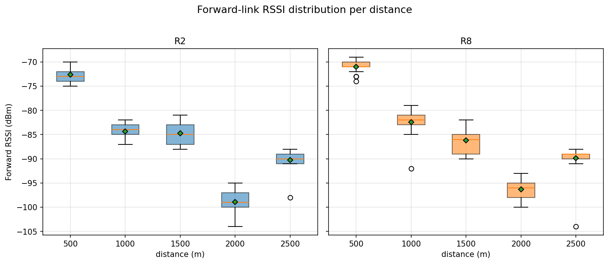
> *Boxplot of forward RSSI distribution per distance for both devices*

### 3.R2 vs R8 Comparison
---

#### Discussion.

- **Forward link (RSSI at the T3-S3).** The two boards track each other within **±3 dB at every distance**. R8 is ahead at 500 m (−1.6 dB), 1000 m (−1.9 dB) and 2000 m (−2.7 dB); R2 is ahead at 1500 m (+1.5 dB); at 2500 m they are effectively tied (0.4 dB). The sign flips between distances, and a 1–3 dB spread is normal run-to-run variation for a single 25-packet sample (per-run RSSI σ ≈ 1.1–3.1 dB). On the forward link **no consistent winner emerges** — R8 is nominally better at 3 of 5 distances, but by margins inside the measurement noise.

- **SNR** mirrors the RSSI results (same sign at every distance), confirming the differences are genuine link-strength differences rather than noise-figure artifacts.

- **Round trip (talkback).** This is where the boards diverge. R8 is clearly better at 1500 m (100 % vs 96 %) and at 2000 m (70 % vs 35 %) — R8 held the return link twice as reliably at 2000 m. However, R2 is dramatically better at 2500 m (80 % vs 4 %). Because R8's 2500 m collapse dominates the totals, **R2 wins overall round-trip reliability (82.9 % vs 74.8 %)** despite R8's forward-link edge.

- **Verdicts.** R8 achieves PASS at 1500 m while R2 is MARGINAL there (a single failed talkback: packet 7). Both are MARGINAL at 2000 m and 2500 m.

- **Interpretation.** The ESP32-S3R2 vs S3R8 module differences (flash/PSRAM variants) are not expected to change RF performance, and the data bears that out on the transmit side. The asymmetric 2500 m talkback result points to a **receive-side/environmental event at the R8 position during that run**, not a weaker transmitter (see §5 and §7).

### 4.Path-Loss Trend vs Distance
---

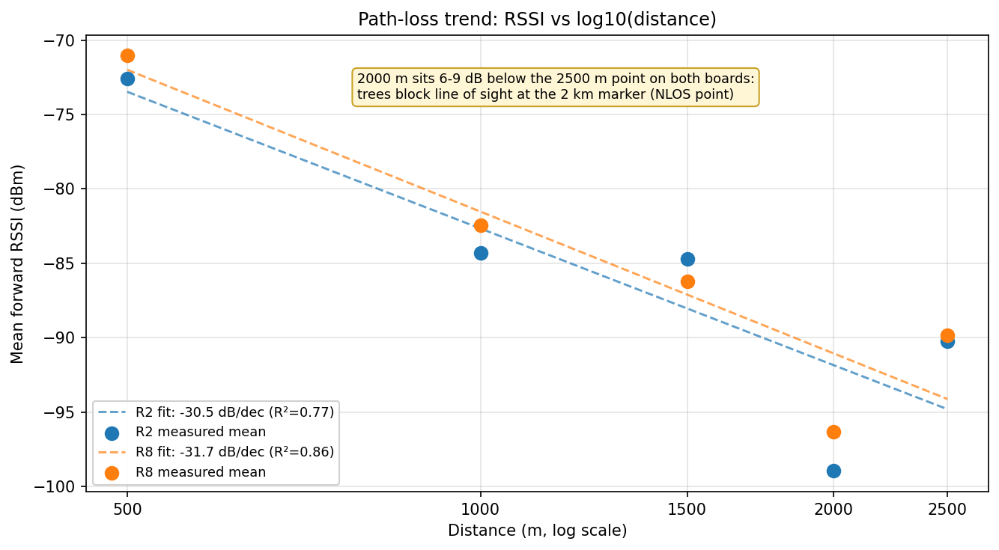
> *Path loss fit, RSSI vs log10 distance*

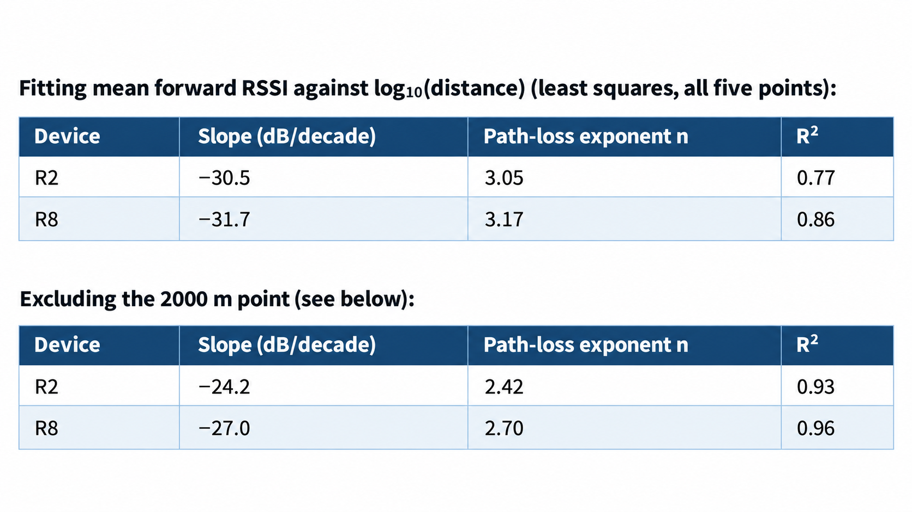

#### Comments on consistency.

- The trend is **monotonic from 500 → 1500 m** and then **2000 → 2500 m behaves oddly:** 2000 m reads **worse than 2500 m on both boards — by 8.8 dB (R2: −99.0 vs −90.2) and 6.5 dB (R8: −96.3 vs −89.8)** — and the TB link shows the same inversion (R2: 7.4 dB, −111.9 vs −104.5; R8: 6.4 dB, −110.4 vs −104.0). Because the inversion appears identically on both devices and in both directions, it is a property **of the 2000 m site/path**, not of either radio. **Known cause:** trees block line of sight at the 2 km marker (site survey) — the only obstructed point on the route.

- With the 2000 m site excluded, the fit is very clean (R² = 0.93–0.96) with n ≈ 2.4–2.7 — slightly worse than free space (n = 2), typical for an open/semi-open ground path at ~900 MHz.

- The 1000 m and 1500 m points for R2 are nearly identical (−84.3 / −84.7 dBm), i.e. the path lost almost nothing over that extra 500 m — again consistent with location-to-location variation dominating small distance steps.

- Full five-point fits (n ≈ 3.0–3.2, R² = 0.77–0.86) understate the underlying regularity because they are dragged down by the 2000 m site; for prediction, the four-point fits excluding 2000 m are more representative of these paths.

### 5.Return-Link (Talkback / TB) Analysis
---

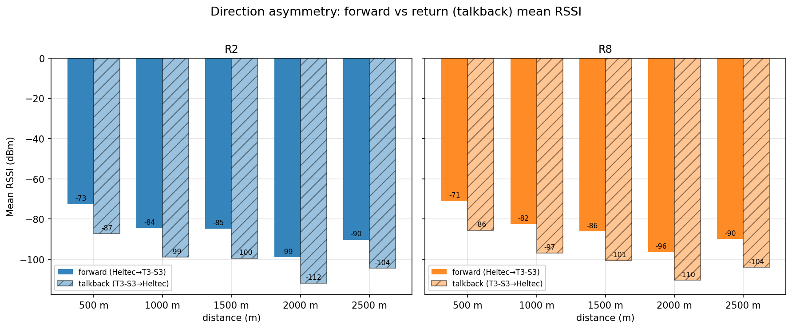
> *Forward vs talkback mean RSSI per device*

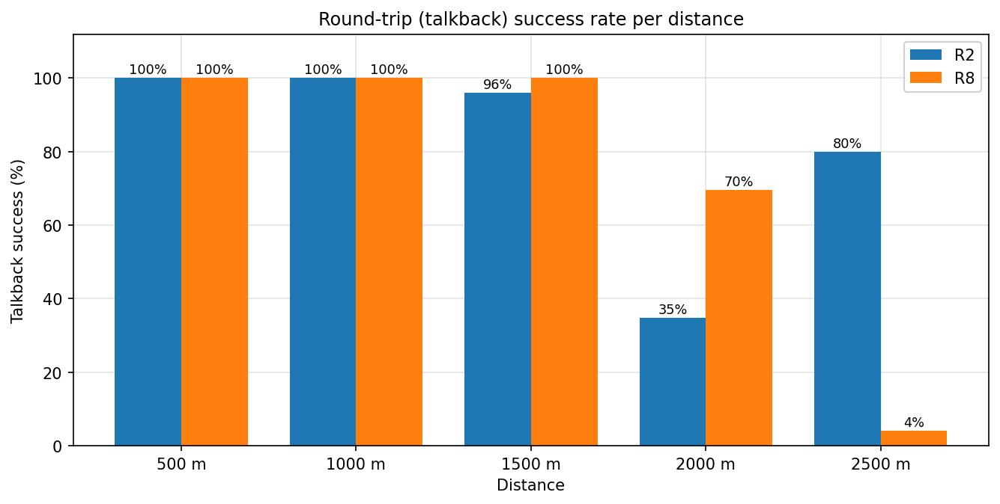
> *Talkback success rate per distance*

#### Direction asymmetry. 
Forward minus return RSSI, averaged over the run, is **14.3 dB (R2) and 14.3 dB (R8)** —remarkably consistent per distance (12.9–14.8 dB across all ten runs). This matches the expected ~15–25 dB asymmetry (lower end), caused by the Heltec receive path passing through its FEM while the T3-S3 receive path does not. Note additionally that the talkback signal originates from the T3-S3's **PA-less transmitter**, so the return link also starts from a much lower radiated power than the forward link — it is doubly disadvantaged (reflected in §8's next steps).

**Return-link levels vs forward levels per distance (mean RSSI):**
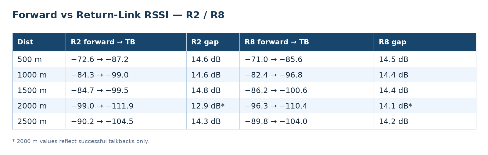

**Note.** The 2000 m gap is smaller only because the TB average is computed over the subset of *successful* talkbacks (15 of 23 rows failed on R2, 7 of 23 on R8); the failed rows have no value at all, so the true return-link mean is worse than shown.

**Talkback / ack reliability.**

- **100 % round trip at 500 m and 1000 m for both boards.**

- **R2 @ 1500 m:** 24/25 (96 %) — the single failure (packet 7) is what demotes the run from PASS to MARGINAL.

- **R2 @ 2000 m:** 8/23 (35 %) — failures on packets 2, 3, 4, 6, 8, 9, 11, 13, 16, 17, 18, 20, 23, 24, 25.

- **R8 @ 2000 m:** 16/23 (70 %) — failures on packets 4, 9, 11, 15, 19, 20, 22.

- **R2 @ 2500 m:** 20/25 (80 %) — failures on packets 8, 12, 14, 15, 23.

- **R8 @ 2500 m: 1/25 (4 %)** — only packet 19 succeeded (−104 dBm / −6.5 dB); every other talkback timed out.

**Where the verdict is not PASS, and why.** All four non-PASS verdicts (R2 @1500/2000/2500, R8 @2000/2500) are caused exclusively by missing talkbacks — the forward data link was received in every recorded case. The verdict follows the return path, not the transmit path:
- Failures correlate with return-link level: runs whose mean TB RSSI was ≈ −86 to −101 dBm (500–1500 m) were 96–100 % reliable; the runs averaging −110 to −112 dBm (2000 m) collapsed to 35–70 %.

- **The R8 2500 m anomaly is different:** its return-link level when it worked (−104 dBm, single sample, SNR −6.5 dB) is the same as R2's healthy 2500 m average (−104.5 dBm), yet 24 of 25 talkbacks were lost. The forward link that run was normal (−89.8 dBm, tied with R2). This pattern — normal transmit, normal receive sensitivity when it works, near-total round-trip loss — suggests a **run-local problem at the R8 receive side** (e.g. elevated local noise/interference at that spot during the 2500 m session, a receive-window timing glitch, or an intermittent antenna/SMA issue) rather than a marginal RF link.

### 6.Link Margin Estimate vs −132 dBm Sensitivity
---
Judged against the SX1262 SF7/BW125 sensitivity of ≈ **−132** dBm, margin = observed RSSI − **(−132)**.
**Forward link — worst observed packet per run:**
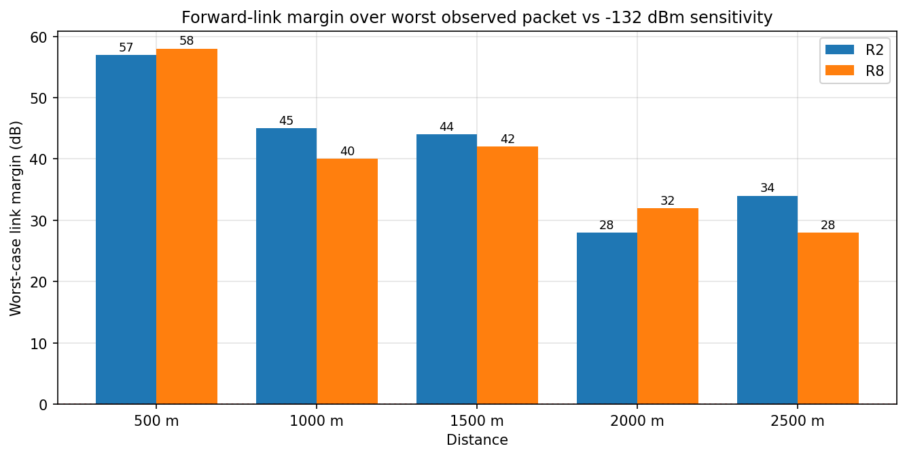
> *Forward link margin vs distance*

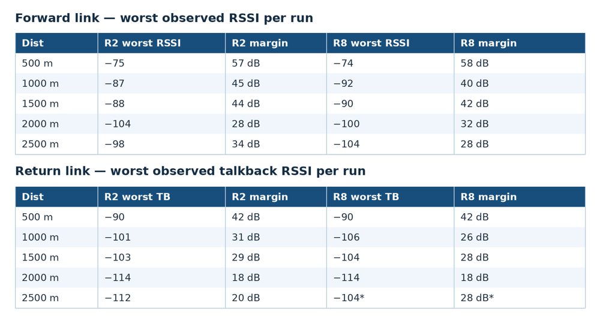

* R8 @2500 m has only one successful talkback sample; its "worst TB" is that single value and must not be read as a stable measurement.
**Projection.** The forward link always kept ≥ 28 dB of margin over every observed packet at every tested distance, so the data link is far from the sensitivity cliff (SNR was positive at all times except isolated deep fades such as R2 2000 m min SNR −6.75 dB). **The return link is the limiting factor:** talkbacks already failed intermittently when the return link averaged ≈ −110…−112 dBm (18–22 dB nominal margin). Using the four-point slopes (excluding the 2000 m site), the return link degrades ≈ 24–27 dB per decade of distance; extrapolating from 2500 m (≈ −104.5 dBm) gives ≈ −109…−110 dBm at 4 km — i.e. **at 4 km the round trip would sit right at the level where 2000 m failed 30–65 % of the time.** Expect the forward link to keep working well beyond 4 km while full round-trip PASS results stop somewhere between 2.5 and 3.5 km with the present setup and antenna placement. (Extrapolation is indicative only — it assumes the same environment and does not model fading statistics.)

### 7.Anomalies, Missing Data, and Data-Quality Caveats
---
All of the following are stated rather than hidden:

1. **Missing rows (4 of 250 slots).** R2 @2000 m: packets **12 and 14** have an entirely empty block; R8 @2000 m: packets **7 and 21** have an entirely empty block. They are counted as 8 % "loss" in the tables (23/25 recorded). Whether those packets were never transmitted (run stopped/aborted) or simply not logged cannot be determined from the CSV. **No distance block is entirely empty** for either device, and **no verdict cell is blank** in either file.

2. **-,- talkback rows.** 21 rows on R2 and 31 rows on R8 have `-,-` in the TB columns: the data packet was received by the T3-S3, but no talkback arrived in the 200 ms window. These rows are excluded from TB RSSI/SNR averages (they have no value), which **biases the TB averages optimistically at 2000/2500 m.** R8 @2500 m has only one TB sample, so its TB statistics are effectively a single point.

3. **2000 m site inversion.** Both boards, in both directions, read 6–9 dB worse at 2000 m than at 2500 m (forward: 8.8 dB on R2, 6.5 dB on R8; talkback: 7.4 dB on R2, 6.4 dB on R8). Cause **confirmed by the test operator: trees block line of sight at the 2 km marker** — the only obstructed point on an otherwise open coastal path. The 2000 m data is therefore a NLOS sample and should not be pooled naively with the LOS points in path-loss fits.

4. **Non-monotonic 1000/1500 m on R2.** −84.3 vs −84.7 dBm — essentially flat; small-site variation, not a measurement error.

5. **First-packet dips.** Several runs open with a weaker first packet (e.g. R8 @1000 m packet 1 = −92 dBm vs ≈ −82 dBm for the rest; R8 @2500 m packet 1 = −104 dBm vs ≈ −89 dBm; R2 @2500 m packet 1 = −98 dBm vs ≈ −90 dBm). Possible settling/AGC effect or momentary fade; worth re-checking with repeat runs. These first packets also dominate the min column, which is why worst-case margins at 1000 m and 2500 m look worse than the averages suggest.

6. **No saturation observed.** The note about T3-S3 RSSI saturating near 0 dBm applies at very close range; at the closest tested distance (500 m) readings were −69…−75 dBm, i.e. far from saturation. No values required discarding for that reason.

7. **No FAIL verdicts** were produced; every non-PASS run is MARGINAL. All verdicts within a distance block are uniform (one verdict per run, no conflicts).

8. **Remaining environmental metadata gaps.** The CSVs carry no timestamps, antenna type/height/polarization, or weather. The site is known (East Coast Park coastal path, map in §1) and the 2000 m obstruction is identified (trees blocking line of sight), but the R8 @2500 m talkback collapse (1/25) is still unexplained by the data — it can only be confirmed by re-running that session. The T3-S3's lack of a TX power amplifier (§8) is likewise a setup fact, not visible in the CSVs, and applies to every talkback row.

9. **Method.** Packet loss = missing rows vs the expected 25 (not provable over-the-air loss). Averages are arithmetic means of the recorded rows; SNR/TB statistics exclude `-,-` cells; R² values are from ordinary least-squares fits on log₁₀(distance). All computations were scripted from the raw CSVs (analyze.py, graphs.py) — no numbers in this report were typed by hand.

### 8.Conclusions and Recommended Next Steps
---
**Conclusions.**

1. **Both boards pass cleanly to 1000 m:** 100 % packet reception and 100 % round-trip success at 500 m and 1000 m, ≥ 40 dB forward-link margin.

2. **Forward-link performance is effectively equivalent:** R2 and R8 agree within ±3 dB at every distance; the sign of the difference changes with distance, so neither board is provably better on transmit. Nominal edge to R8 (better at 3 of 5 distances), inside run-to-run noise.

3. **The return (talkback) link decides every non-PASS verdict.** The forward data link never failed in any recorded packet; all MARGINAL ratings come from missing talkbacks.

4. **Round-trip reliability:** R2 82.9 % overall vs R8 74.8 % overall. R8 is much better at 2000 m (70 % vs 35 %), R2 vastly better at 2500 m (80 % vs 4 %). The latter looks like a run-local receive-side failure on R8, not a hardware deficit — its forward link that run was normal.

5. **The 2000 m point is the weakest path** for both boards (forward −96…−99 dBm, return −110…−112 dBm, return success only 35–70 %) and behaves unlike the 2500 m point: **trees block line of sight at the 2 km marker**, so this is a known obstruction effect, not a device fault.

6. **Path loss follows a normal log-distance law** (n ≈ 2.4–2.7, R² ≥ 0.93) once the 2000 m site is excluded; the full five-point fit gives n ≈ 3.0–3.2 with lower R².

7. **Limiting factor going further:** the return link, which is ~14.3 dB weaker than the forward link on both boards. Forward margin stays ≥ 28 dB to 2500 m, but the round trip is already intermittent once the return link averages ≈ −110 dBm — extrapolation puts 4 km roughly at that boundary.

**Recommended next steps.**

1. **Remove the T3-S3 from future testing as the reference/talkback node.** Its transmitter has **no power amplifier**, so its radiated TX power is far below the Heltec boards' ~22 dBm FEM output. As the return-link transmitter it under-drives the link, and every non-PASS verdict in this report was decided by that weak return link — the round-trip results therefore characterise the T3-S3's TX shortfall at least as much as the Heltecs. Replace it with a PA-equipped reference node (22 dBm+), or take the ground truth from the mesh stack's own delivery/ack metrics, so round-trip figures reflect the R2/R8 transmitters rather than the reference node.

2. **Re-flash both R2 and R8 with Meshtastic firmware and repeat the distance runs to test reliability in a mesh network.** Run both boards at the same 500 m – 2.5 km markers with identical Meshtastic settings and compare mesh-level metrics instead of a single point-to-point round trip: packet delivery ratio / acknowledged-message success per distance, behaviour of the Meshtastic stack (routing, retries, hop handling, channel settings), and R2 vs R8 under identical mesh conditions — including whether the 2 km (trees, NLOS) and 2.5 km points stay reliable in a real mesh deployment.

---

*Report generated 5 October 2026. All statistics and graphs computed directly from R2.csv and R8.csv via analyze.py and graphs.py in their respective project folder.*

**Special Thanks to Dave Cuyler**

We would like to extend our sincere thanks to **Dave Cuyler** for conducting the field tests and generously sharing his detailed results and data. All testing and data presented in this report were provided by Dave. We greatly appreciate his time, effort, and valuable contribution to the Heltec community.

