*Author: Igor Krasnodymov · MIT licence · [GitHub](https://github.com/IKrasnodymov/meshmesh) · [Website and browser installer](https://ikrasnodymov.github.io/meshmesh/)*

MeshMesh is an open-source firmware for LoRa boards. It runs on the [MeshCore](https://github.com/meshcore-dev/MeshCore) network and stays compatible with standard MeshCore nodes, repeaters, room servers and the official MeshCore apps. Its main idea is to use the mesh **straight from the device**: chats, channels, contacts and settings live on the board's own screen and button, so no phone is required. When you want a phone, there is an Android app and a web page.

Two Heltec boards are among the main test boards of the project and are tested on real hardware:

| Board | Screen and controls | Connectivity |
|---|---|---|
| **Heltec WiFi LoRa 32 V4** (ESP32-S3, SX1262) | 128×64 OLED, the PRG button | Wi-Fi access point and web page, Bluetooth LE, USB |
| **Heltec Mesh Node T114** (nRF52840, SX1262) | 240×135 colour TFT, the USER button, L76K GPS (optional) | Bluetooth LE, USB |

The Heltec V4-R8, V3 and Wireless Tracker targets are also built, but they have not yet been run on hardware.

## Heltec WiFi LoRa 32 V4

The V4 gets a one-button interface: a **click** goes to the next screen, a **hold** opens the actions of the screen (reply, announce the node, open a game, change a setting).

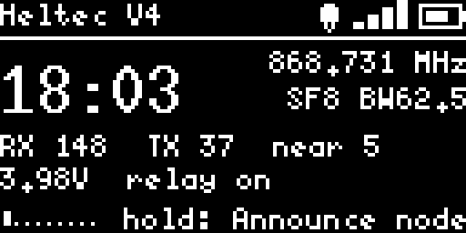

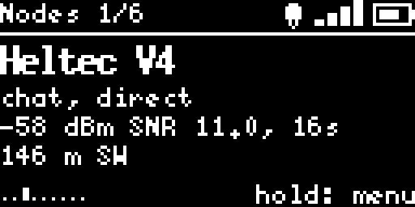

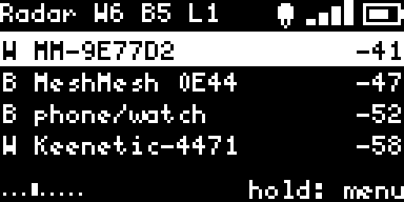

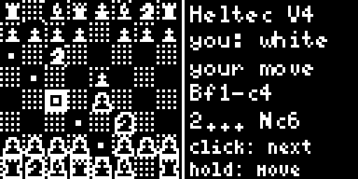

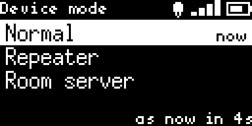

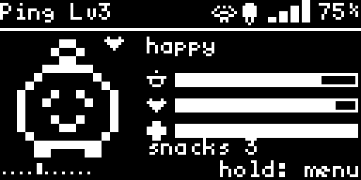

- **Messages**: direct chats and channels (hashtag, `meshcore://` link or QR, key, invitations), delivery receipts, the route of every message.
- **Nodes**: signal, hops, distance and bearing; announce the node, share the position.
- **MeshCore regions**: a default region and one per channel, and a search of the regions served by nearby repeaters.
- **Repeater and room server modes**, chosen at boot with the button or in the settings; admin login and remote CLI from the MeshCore app.
- **Signal radar** for Wi-Fi, Bluetooth and LoRa with "warmer / colder" homing, and a Wi-Fi CSI motion sensor between two boards.
- **Wardriving**: a coverage map of the mesh, exported to CSV, GeoJSON, KML and WiGLE.
- **Chess** with contacts over the mesh (Elo ratings and Swiss-system tournaments), a **network pet** that feeds on radio traffic, and the **DIC3R dice** roller.
- **Web page** over the board's own Wi-Fi access point: chats, map, nodes, radar and settings in a browser.

## Heltec Mesh Node T114

The T114 has its own colour interface, drawn at the native 240×135 resolution, with the same one-button logic.

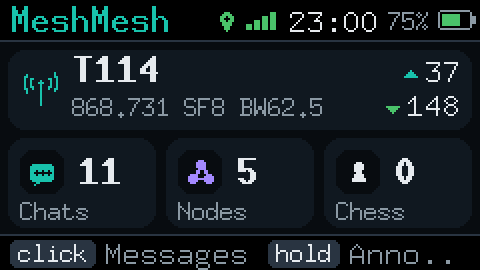

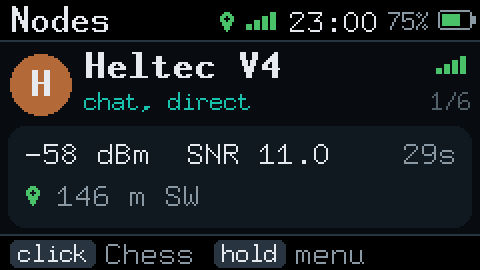

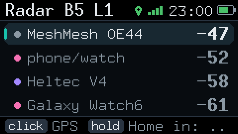

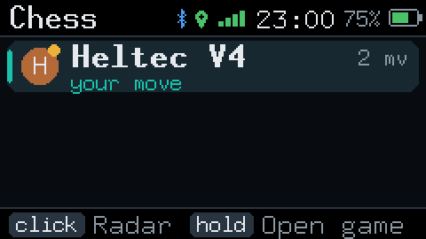

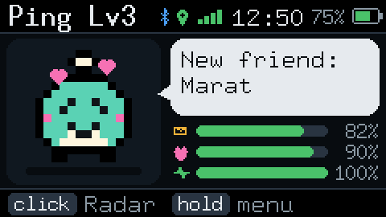

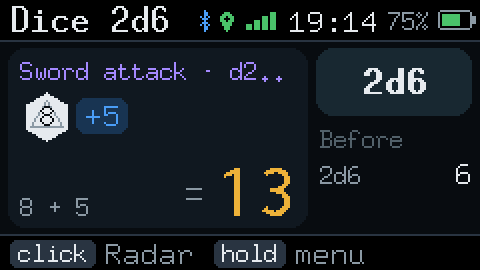

It has messaging, nodes, regions, repeater and room server modes, chess, the pet and dice, as on the V4. The radar covers Bluetooth and LoRa (the nRF52840 has no Wi-Fi). Position and clock come from the L76K GPS on boards that have it fitted. The phone connects over Bluetooth LE (PIN pairing) or USB.

## Android app and the official MeshCore apps

The MeshMesh Android app shows the device's own interface on the phone over Wi-Fi (V4), Bluetooth or USB. It adds notifications, offline maps with relief kept on the phone, and the packet path of every message: which repeaters passed it on, with SNR and RSSI.

  
  
  

Both boards also speak the **MeshCore companion protocol**, so the official MeshCore apps connect to them over Bluetooth or USB and work with the board's chats, contacts and channels.

The device screens, the web page and the app are available in 15 languages: English, Chinese, Russian, Ukrainian, Spanish, Portuguese, French, German, Italian, Polish, Turkish, Japanese, Korean, Arabic and Indonesian.

## Installation

Open the [MeshMesh website](https://ikrasnodymov.github.io/meshmesh/#install) in Chrome or Edge on a computer, connect the board over USB, choose the board and the screen language, and press **Install**.

- **Heltec V4**: the installer writes the firmware over USB. Tick "Erase device" only when coming from other firmware; MeshMesh updates keep the key, contacts, settings and history.
- **Heltec T114**: press **RESET twice** quickly to enter the bootloader when the board runs other firmware, then press **Install** (serial DFU in the browser). Alternatively, after a double RESET an `HT-n5262` drive appears, and `firmware.uf2` from the website can be copied onto it.

Default radio profile: 868.731 MHz, BW 62.5 kHz, SF8, CR 4/6. Change it in Settings → Radio; all nodes of a network must use the same profile. Follow the radio regulations of your country.

## Links

- Website, installer and screenshots: https://ikrasnodymov.github.io/meshmesh/
- Source code and documentation: https://github.com/IKrasnodymov/meshmesh
- T114 details: https://github.com/IKrasnodymov/meshmesh/blob/main/docs/en/t114.md
- MeshCore: https://github.com/meshcore-dev/MeshCore

Feedback, bug reports and translations by native speakers are welcome on GitHub.