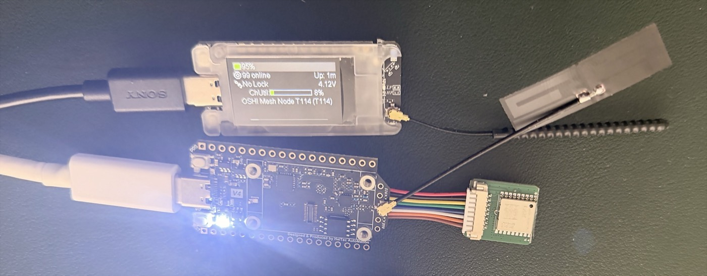
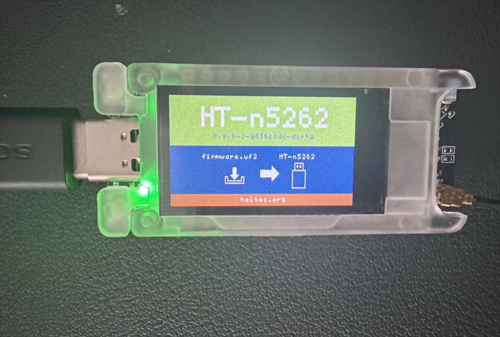
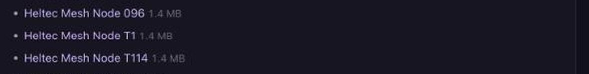

# OSHI on Heltec Nodes: Flashing, and 2,000 Bytes Over a V4-to-T114 Link



[OSHI](https://oshi-messenger.com) is a messenger for iPhone and Android that keeps working when the
network does not. It carries messages over Bluetooth and the local Wi-Fi between
nearby phones, and over LoRa when you give it a radio — and the radio we flash,
carry and test with is Heltec hardware.

This write-up is the hardware half: what we put on a Heltec node, how we put it
there, and what the link between two of them actually measured. Every figure
below is something we read off a device or a log, with the date it was read.

<!-- truncate -->

## Why a node at all

A phone has no LoRa radio. Phone-to-phone, OSHI uses what the phone already has,
and that gets you a room, a building, a demonstration — hundreds of metres at
best, and nothing through concrete. A LoRa node changes the distance class
entirely, and it does it on a battery, with no subscription, no SIM and no
infrastructure to depend on.

So OSHI treats the node as what it is: a radio on the end of a Bluetooth link.
The phone keeps the identity, the keys and the conversation; the node moves
bytes. That split is also why the node does not need to be re-paired, re-flashed
or re-configured when the app updates.

## The hardware

Two Heltec boards are in the photo above and in everything below:

- **WiFi LoRa 32 V3** — ESP32-S3, SX1262, 8 MB flash, 0.96" OLED, JST 1.25 Li-Po
  connector. The one we recommend first: it is cheap, it is everywhere, and it
  flashes from a browser in under a minute.
- **Mesh Node T114** — nRF52840, in a translucent case with a colour display and
  a battery. The low-power one; it flashes by drag-and-drop instead of over a
  serial port, which is a different procedure and worth its own section.

A **WiFi LoRa 32 V4**, in its R8 Expansion Kit form, is the bare board at the
bottom of the photo. It is one of the two ends of the link measured further
down; the T114 is the other.

## Flashing the WiFi LoRa 32 V3

We serve our own build and flash it from the browser, over Web Serial — plug the
board in, pick it, press the button, done. What we verified on real hardware on
**2026-08-03**, read from the flasher's own log:

- the chip came back as **ESP32-S3 rev v0.2** with **8 MB** of flash, matching
  the board;
- the image **MD5 matched the metadata** we publish next to it;
- the write ended with **`Hash of data verified`** — the bootloader read the
  flash back and agreed with what we sent;
- on reboot the node brought the radio up with **`SX1262 init success`** and
  started its BLE module, which is what the phone pairs to.

The OSHI build we ship for this board is version **2.8.0.08722da**, target
`oshi-heltec-v3`. It boots to an OSHI start screen so you can tell at a glance
which image a node is carrying.

### One thing that catches everybody

A new node ships with its **region UNSET**, and a node with no region **will not
transmit at all**. Nothing is broken, and there is no error to find: the radio is
simply refusing to emit on a band it has not been told it may use. Set the region
when you first pair the node and the mesh appears.

## Flashing the Mesh Node T114

The T114 is an nRF52840, so there is no esptool and no serial flashing. It uses
the UF2 bootloader: the board presents itself as a USB drive, you drop a `.uf2`
file onto it, and it reboots itself.



In bootloader mode the display turns into the screen above: **`HT-n5262`**, the
bootloader version — ours read `0.9.0-2-9836c8dc-dirty` — and a drawing of a
`firmware.uf2` file going onto an `HT-n5262` drive, which is exactly the name the
drive takes on the computer. The board announces the same name over USB, as
product `HT_n5262` from vendor `Heltec`, so you can confirm from a terminal that
a board really is in bootloader mode without unplugging anything:

```
"USB Product Name" = "HT_n5262"
"USB Vendor Name"  = "Heltec"
```

Drop the file on the drive; the drive disappears on its own and the node comes
back running the new image. There is nothing to verify by hand — the bootloader
either accepted the file or the drive is still there.

Our flasher lists the Heltec boards it holds images for, with the size of each:



## What we read off the T114

The first photo in this article is a T114 a few minutes after it was flashed.
Its screen is the measurement:

- **`OSHI Mesh Node T114 (T114)`** — the node name, so the build on it is ours;
- **`99 online`** — its own count of the nodes it could see after joining the
  public mesh around us;
- **`Up: 1m`** — one minute of uptime, i.e. it reached that figure almost
  immediately;
- **`ChUtil 8%`** — channel utilisation, with plenty of air left;
- **`4.12V`** and **95%** — the internal battery, which is what you want to see
  on a node you intend to leave somewhere.

## What the phone adds on top

Once a node is paired, OSHI is not sending raw text through it. The app owns the
cryptography and the message format, and the node carries the result, which buys
three things a plain text link does not have:

- **Long messages.** OSHI fragments up to about **11 KB** across LoRa frames and
  reassembles them on the far side, byte for byte. A LoRa frame is a couple of
  hundred bytes, so a long message is tens of frames and takes the time it takes
  — but it arrives whole or not at all.
- **End-to-end delivery receipts.** The receipt comes from the recipient's phone,
  not from a node along the way, so "delivered" means delivered.
- **Store-and-forward.** A message for someone who is out of range is held and
  delivered when they come back, without a server in the middle.

OSHI also talks to nodes running **Meshtastic 2.x** over its published BLE
service, so a mesh you already run keeps working while you try this.

## Over the air, Heltec to Heltec

Everything above is bring-up. This is the link itself, measured on 2026-10-24
between the two Heltec nodes in the first photo:

- **Heltec WiFi LoRa 32 V4 (R8 Expansion Kit)** — `heltec-v4-r8-oled`
- **Heltec Mesh Node T114** — `heltec-mesh-node-t114`

Both on the same OSHI build, **2.8.1.205f0c8**, both on **EU_868** with the
default preset (SF11, coding rate 4:5) and the default transmit power for the
region, about a metre apart on the bench.

One detail makes the numbers mean something: every packet below was sent with
**`hop_limit = 0`**. A packet that may not be rebroadcast can only have arrived
over the direct link, so no other node on the bench could quietly relay it and
flatter the result. These are Heltec-to-Heltec hops and nothing else.

### A short message

Twenty-three bytes, V4 R8 to T114, five times:

| | |
|---|---|
| Delivered | 5 of 5 |
| Fastest | 1,167 ms |
| Median | **1,371 ms** |
| Slowest | 1,594 ms |
| SNR | 6.25 – 6.75 dB |
| RSSI | −26 dBm |

### 2,000 bytes, in both directions

The same payload — 2,000 random bytes — cut into **11 fragments of at most 182
bytes**, sent one at a time, each one on the air only after the previous had
landed. At SF11 a 182-byte frame is seconds of airtime, so pacing is what an
application has to do anyway.

| | V4 R8 → T114 | T114 → V4 R8 |
|---|---|---|
| Fragments delivered | 11 / 11 | 11 / 11 |
| Retransmissions | **0** | **0** |
| Bytes reassembled | 2,000 | 2,000 |
| Identical to the source | yes | yes |
| Per fragment | 2.34 – 2.76 s | 2.34 – 3.14 s |
| SNR | 5.75 – 6.75 dB | 6.0 – 9.25 dB |
| **Total** | **28.8 s** | **28.8 s** |

Two things worth pointing out. Not a single fragment needed sending twice, in
either direction — 22 frames out of 22 on the first try. And the two totals
landed on the same tenth of a second, which is the kind of symmetry you want
between two quite different boards from the same maker: an ESP32-S3 on one end,
an nRF52840 on the other.

The reassembled payload was compared byte for byte against the original, not
merely checked for length.

### What these numbers are not

They are a clean-bench baseline at one metre: no walls, no distance, no
interference. They tell you what the link costs when the radio conditions are
perfect, which is the right floor to measure range against later — not a range
test. A range test is the next thing we owe this page.

## Links

- OSHI — [oshi-messenger.com](https://oshi-messenger.com)
- The node compatibility list, with what was tested and when —
  [oshi-messenger.com/lora/](https://oshi-messenger.com/lora/)
- The flasher — [oshi-messenger.com/lora/flash/](https://oshi-messenger.com/lora/flash/)
- Heltec WiFi LoRa 32 V3 — [heltec.org](https://heltec.org/project/wifi-lora-32-v3/)
